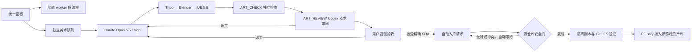

# 无人值守美术资产流程

美术制作已接入无人值守系统的统一面板、队列、持久状态、恢复和验收。实际执行使用独立 `ArtWorker`，不占用功能 worker 的 `CODE` 阶段，不修改正在运行的 M3 工作副本。Claude Opus 5.5 以 `high` 制作和有限返工；独立检查及 Codex 技术审阅通过后，等待用户对精确版本作视觉验收。用户接受后自动排队入库，无需第二次人工审批。

**当前真实状态：L1/L4/L8 样板已完成生产、独立检查和 Codex 技术审阅，正在等待用户视觉验收；本批尚未写入诸国游戏仓库。** 首阶段自动接入的目标是源游戏仓库中的批准资产库，不包括替换游戏住宅表现、修改地块或改变玩法。

统一入口：[本机无人值守面板](http://127.0.0.1:8765/)。日常进入[美术工作室](http://127.0.0.1:8765/#art) 查看多视角预览、本批累计费用、技术检查摘要，并接受或退回当前版本。技术通过与用户视觉验收分别展示；接受后自动进入批准资产库，游戏表现绑定由后续功能任务处理。面板轮询只读公开状态和证据，不启动 provider。旧 `art_tools/run_claude_preview.py` 仅保留历史诊断与互斥兼容，不再是常规任务入口。

返工和技术审核期间，页面将当前任务 `art_review` 绑定的包作为只读“制作过程预览”，使用独立的 `preview_sha256`；旧队列的审批版本不会用来展示新图。此时禁止接受或退回，只有正式进入 `awaiting_approval` 才恢复版本验收。尚未产生新证据时显示制作中；技术阻塞时优先展示实际缺陷，并可展开完整审核记录和解除条件。该展示不改变任务状态、验收结果或入库权限。

## 最终流程与隔离



美术阶段为 `CODE → ART_CHECK → ART_REVIEW`。技术通过后，任务进入 `art_pending`，队列状态为 `awaiting_approval`，worker 回到 `PLAN`；这里的 `PLAN` 是空闲或消费美术队列，不调用普通功能规划器。空队列不克隆游戏、不执行游戏检查、不调用模型。工作时间、暂停、失败上限、会话归属和 provider 重试仍有持久状态约束。

美术运行目录为 `C:/codex-dsh-work/zhuguo-art`，工作副本为其中的 `workspace`，分支为 `unattended/art-preview`；功能开发运行目录仍为 `C:/codex-dsh-work/zhuguo-city`。本轮部署和恢复只重启美术 worker，现场对照确认功能 worker 的 PID 和运行绑定未变化。这不表示两个进程不会竞争 CPU/GPU 资源。

worker 持有本美术运行目录的 `art-worker.lock`、`controller.lock` 和旧入口的 `claude-runner.lock`，防止重复执行器覆盖断点；生产时不取得功能项目锁。后台复用现有 Windows 监督、进程身份、心跳和恢复机制，空闲或等待验收时低频轮询。旧单次执行器状态须先归档，不能静默覆盖后交给新 worker 接管。

## 配置、模型与权限

主配置只增加面板路由，不将美术派发到运行中的功能 worker：

```json
{
  "art_worker": {
    "config_file": "C:/codex-dsh-work/zhuguo-art/worker.json"
  }
}
```

独立 worker 的完整配置另外包含以下片段；片段本身不是完整配置：

```json
{
  "coding_provider": "claude",
  "art_pipeline": {
    "config_file": "C:/codex-dsh-work/zhuguo-art/approved/HOUSE-COMMON-001.json",
    "task_ids": ["TASK-ART-0001"],
    "artifacts_dir": "C:/codex-dsh-work/zhuguo-art/batches/HOUSE-COMMON-001"
  },
  "art_promotion": {
    "target_config_file": "C:/Users/wy331/OneDrive/文档/ChatGPT/gpt_chain_deepseek/unattended.local.json",
    "target_branch": "main",
    "push": false,
    "remote": "origin"
  }
}
```

两类 worker 的项目和运行目录必须分离。美术配置不能含功能里程碑发布策略或递归 worker 路由。任务入队冻结可信批次配置的 SHA-256；任务 ID、配置路径和产物路径均精确绑定。非密钥批次 JSON 放在只含该文件的专用 `approved` 目录，不能与可写工作副本、产物、私有账本或密钥目录重叠。

Claude 入口必须匹配 `task.kind=art`、持久 `CODE` 阶段、本轮 operation 的任务 ID/输出目录和独立工作副本。只追加固定解释器、固定 `art_pipeline.py`、可信 `--config` 和 `preview` 的精确命令；不开放通用 Python、任意 Bash、直接 Tripo HTTP 或额外 MCP。新增只读范围仅为公共产物、固定脚本目录、解释器目录和专用配置目录，保持禁止编辑及 `blockReadsOutsideWorkingDirectories`。Claude 不读取密钥或私有账本。Codex 美术审阅只读公共证据，无生产、配方编辑或发布权限。

编码固定请求 `claude-opus-5-5` 和 `--effort high`，并核对原生回执实际模型；请求值、观察值和 `model_verified` 保存在 `process.json` 与任务记录中。`high` 的证据来源是实际 CLI 参数；原生初始化事件不回报服务端档位，因此不宣称服务端独立证实了思考档位。

## 范围、配方与版本

当前唯一可执行批次为 `HOUSE-COMMON-001`，范围是普通住宅 `L1/L4/L8` 和复用的生活道具。风格、参考文件哈希、人物尺度、材质、色彩、光照和镜头约束来自已确认参考与可信批次。朴素材料不降低制作精度。用户提供的 Tripo/Blender 测试总结是实现参考，不能据此扩大制作范围。

可信批次可指定独立工作副本内的 `recipe_file`。Claude 只能编辑该文件；顶层仅允许 `version: 1` 和 `assets`，按批准顺序保留全部三级，每项仅允许以下字段：

| 字段 | 边界 |
| --- | --- |
| `asset_id` | 必须匹配批准资产，不可改名、增删或重排 |
| `revision` | `v001` 至 `v999`，不得低于批准基线 |
| `prompt` | 非空，最多 8000 字符；改变生成提示必须采用新 revision |
| `target_height_m` | 1.5 至 8 米 |
| `max_footprint_m` | 两维各至少 1 米，且不超过批准上限 |
| `front_rotation_deg` | 仅 0、90、180、270 |

等级、预算、参考、私有路径和命令不可通过配方更改。重做源形态时只更新有问题的级别，其他级别复用；单纯尺寸或朝向处理可保留模型 revision。配方原始字节另存不可变快照，SHA 绑定生产输入、Blender manifest、验收包和检查。

控制器仅允许精确配方文件变化，其他 tracked、untracked 或 ignored 文件改动均被拦截。生产完成后，先核验当前配方、验收包、产物和预算，再持久化提交意图并提交配方。原始 `base_sha` 保留；`art_workspace_head`、候选和 `expected_head` 更新为控制器提交后的版本，后续检查和审阅绑定新版本。提交中断恢复必须核对唯一父提交、唯一文件、任务标题及配方/验收包哈希，不重复提交或生成。

## 技术检查与用户视觉验收

生产顺序为参考版本 → Tripo 概念/模型 → 下载归档 → Blender 处理 → UE 5.8 导入/真实截图 → 验收包。`ART_CHECK` 执行固定 `verify`，不调用 Tripo、不读密钥、不启动 Blender/UE、不改 `Content`，仅写公共独立检查回执。

检查覆盖处理产物、FBX/Blend/材质哈希、UE 包和导入脚本绑定、八张不同真实截图、截图与当前导入/采证脚本绑定、内嵌回执一致性、配方与处理输入，以及当前本地预算和费用结清。命令退出零、图片存在或 Claude 声明完成均不能替代检查。

Codex 技术审阅前后、用户接受时及消费接受决定时，重新核验当前产物和预算，不改写已绑定检查回执。技术 `accepted` 只表示可提交用户视觉验收。用户 `accepted/rework` 必须附意见并绑定完整 `review_package_sha256`；包变化后不能沿用旧决定。返工保持同一任务/会话，并受次数、配方和预算边界约束。

## 用户接受后的自动入库

接受后自动生成幂等 `promotion-requests.json` 请求并消费。它必须对应持久 `art_history` 中的用户接受和技术通过，并重新核验精确包、检查、产物及预算。未接受资产不能进入源游戏仓库。

首阶段仅加入当前批准的 `/Game/ArtPreview/Versions/V_<hash>` 对应 `.uasset` 包及该版本依赖，保持 UE 路径不变；同时在 `Content/Data/ArtApproved/<batch>/P_<hash>/` 保存批准目录和原始 manifest，记录等级映射、布局、完整验收哈希及用户决定。不复制展示地图或旧的未批准版本，不改功能源码、游戏配置、成长规则、建造目录、存档或运行中的 M3 工作副本。

目录明确标记 `gameplay_binding: not_modified`。资产入库不等于游戏住宅画面已替换。现有开发住宅仍是 4 米网格下的 `1×1`，样板庭院为 16 米；表现适配和存档兼容须作为后续有限工程任务处理，不能静默缩小庭院或扩大已占用地块。

消费者检查源仓库分支、tracked 改动、批准目录内的 untracked/ignored 冲突和 UE 编辑器占用，在独立副本准备提交，验证 Git LFS 对象、精确允许的 diff、目录和布局哈希，再持源项目锁做 fast-forward-only 接入。历史日志保留，不清理用户文件。功能执行器持锁、目标有改动或编辑器占用时记录 `waiting_target_*`，自动等待，不打断功能流程，也不增加人工审批。中断后按候选和源 HEAD 对账；资产和 LFS 对象用临时文件及原子替换复制。

当前 `push: false`，只接入本地源仓库。检查或接入失败如实保留，不自动降低标准。

## 积分、失败与恢复

Tripo 批次硬上限为 **3000 积分**，没有额外的 1200 子额度。提交前按实际消耗、预留和未知提交之和检查余额；官方任务回执是费用依据，估算不是结算。Claude/Codex 自身使用量不计入这份 Tripo 积分账本。

截至下述真实验收版本，累计 **260 积分**：初始三级各一组概念/模型共 195，随后仅 L1 `v002` 新增 65；L4/L8 复用已有任务和模型。预留与未知均为 0，剩余 2740。剩余额度不代表授权花满，也不自动释放其余等级或新批次。

发送请求前持久化意图；响应丢失形成 unknown 时保留预留，不盲目重复 POST。同标签不同请求被拒绝。任务成功与下载成功分别记录，查询复核文件大小和哈希；缺失或损坏不再报告 ready。本地尺寸、旋转、材质和展示问题优先重跑处理，不用付费重生代替恢复。

失败不等于退款。终态明确给出 `credits_consumed` 才据此结算预留，缺少费用继续按未知处理。已记费用不会因后续较低回执自动回减；退款需要单独有证据的对账，当前入口不自动办理退款或扩大可用预算。

已完成 CODE 先恢复原回执，provider 暂时不可用沿用原任务和会话。对于“生成完成、配方尚未提交”的阻塞，仅停止美术 worker，使用 `ArtWorker.retry()`，不传 `rework/new_session`，再恢复并启动。它保留成功操作回执，核验并提交配方后进入 `ART_CHECK`，不再调用模型。不得手改断点或直接调用旧单次入口绕过恢复。

## 当前真实证据（2026-11-06）

| 项目 | 已观察结果和证据 |
| --- | --- |
| Claude 制作 | [code-97d6…/process.json](C:/codex-dsh-work/zhuguo-art/runs/code-97d6cc1f19ba46f1a9fb15a8a09e82b6/process.json)：退出 0，实际模型 `claude-opus-5-5`，`model_verified: true`，请求 effort 为 `high` |
| 独立检查 | [independent-check.json](C:/codex-dsh-work/zhuguo-art/batches/HOUSE-COMMON-001/independent-check.json)：11 项通过，260/3000，预留和未知均为 0 |
| Codex 技术审阅 | [review-556b…/result.json](C:/codex-dsh-work/zhuguo-art/runs/review-556bcbd3e306453bb6a3abcf8458520d/result.json)：`accepted`，明确仍待用户视觉验收 |
| 美术受审 HEAD | `a08fbb05318d5c3be9fdfd1c1e948d5be48ae149` |
| 当前验收包 | [review-package.json](C:/codex-dsh-work/zhuguo-art/batches/HOUSE-COMMON-001/review-package.json)，SHA-256：`9b4c644c2a6bedb956c6cfa99159a19dde98aedd1998125e79f4ca13368a1709` |
| 用户验收 | `TASK-ART-0001` 在 `art_pending`，状态 `awaiting_approval`；当前 `PLAN` 表示美术 worker 等待队列 |
| 真实面板 | [verification.json](C:/codex-dsh-work/art-assets/dashboard-deployed-validation-20261106/verification.json)：PASS，八张图片的服务端内容哈希一致，无浏览器错误；验收按钮可用但未点击，功能 worker PID 前后均为 2956 |
| 正式入库 | 用户批准 0、入库请求 0、待验收 1；源游戏仓库和运行中的功能工作副本均无 `Content/ArtPreview`。目前入库验证使用临时仓库的合成资产 |

这些证据证明三级生产及技术链路实际跑通，不证明用户已认可画面、八级已制作或游戏表现已接入。

## 操作与回归

在工具仓库根目录使用主配置路由到独立 worker：

```powershell
.\.venv\Scripts\python.exe -m unattended art status --config unattended.local.json
.\.venv\Scripts\python.exe -m unattended art start --config unattended.local.json
```

面板接受/返工携带当前包哈希。CLI 等价入口为 `art resolve --task TASK-ART-0001 --decision <决定> --feedback <明确意见> --review-package-sha256 <完整当前哈希>`，其中决定只能为 `accepted` 或 `rework`，并须带 `--config unattended.local.json`；仅在用户已作出对应视觉决定时提交。维护用 `python -m unattended.art_pipeline --config <可信批次绝对路径> status` 只读状态，`verify` 做本地独立检查；`preview` 属于付费及 DCC 生产入口，由已绑定任务调用。

专项回归可运行：

```powershell
.\.venv\Scripts\python.exe -m unittest discover -s tests -p 'test_unattended_art*.py' -q
```

最终合并回归：**22 个模块、309 项全部通过，耗时 431.055 秒**。范围为全部 `test_unattended_art*.py`，以及存在的原 Engine、恢复、暂时失败重试、规划模型、Claude provider、配置、面板、CLI 和后台监督测试；按文件存在性筛选并去重。完整命令：

```powershell
$artModules = @(Get-ChildItem tests/test_unattended_art*.py | ForEach-Object { 'tests.' + $_.BaseName })
$baseModules = @(
  'engine', 'recovery', 'transient_retry', 'planning_models', 'claude_provider',
  'config', 'planning_model_config', 'dashboard', 'dashboard_state', 'cli', 'background'
) | ForEach-Object { 'tests.test_unattended_' + $_ }
$modules = @(($artModules + $baseModules) | Where-Object {
  Test-Path -LiteralPath ($_.Replace('.', '/') + '.py')
} | Sort-Object -Unique)
& .\.venv\Scripts\python.exe -m unittest @modules -q
```

其中入库专项 10 项测试使用合成 `.uasset` 字节及真实临时 Git/LFS，覆盖接受门槛、版本过滤、无功能改动、源仓库占用/冲突、未知费用、原子复制和中断幂等；这不是向真实游戏导入资产的验收。合并回归未调用付费 API 或真实 Blender/UE。真实生产、独立检查、Codex 审阅和浏览器验证的证据另外列于上表，不与离线回归混算。

## 后续需求计划

[ART_MODEL_NEEDS_PLAN.json](C:/Users/wy331/OneDrive/文档/ChatGPT/gpt_chain_deepseek/docs/ART_MODEL_NEEDS_PLAN.json) 按现有住宅规则、内容目录和功能矩阵排出当前批次之后的五批需求：普通住宅其余五级、市场与仓储、民生文化服务、生产与农业、精英住宅。这是需求优先级，不是任务派发或付费许可。

五个后续批次均禁用付费生成，没有新增 API 预算。其余普通住宅若后续释放，优先复用样板和道具并受原批次剩余额度约束；其他批次需各自明确范围和资金。当前执行入口仍固定单批三级，尚未实现通用多批注册和任意等级制作，不能将需求 JSON 的存在当成这些能力已经实现。
